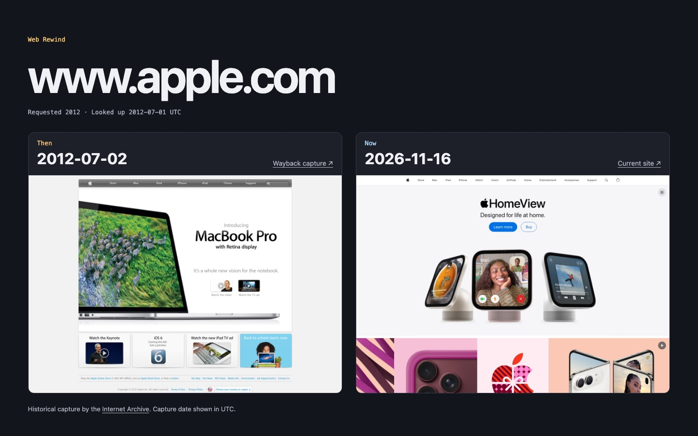

# Web Rewind

**Give a website a date. See what the web looked like then.**

给网页拨个时间。输入一个网址和日期，把真实的 Wayback 历史快照和今天的网页放在一起看。

[Try Web Rewind in your browser](https://1748468904-bit.github.io/web-rewind/)



Open [`docs/index.html`](docs/index.html) from your local checkout to look up any public URL. The [Apple demo](docs/apple-2012.html) has both screenshots embedded and opens offline.

## Install

Install into Codex with the [Skills CLI](https://github.com/vercel-labs/skills).

```sh
npx skills add 1748468904-bit/web-rewind -a codex
```

## Try it

> Use `$web-rewind` to take apple.com back to 2012 and compare it with today's homepage.

> 用 `$web-rewind` 带我回 2012 年的苹果官网，和现在的首页比一比。

You can also run the helper directly with Python 3.9 or newer.

```sh
python3 scripts/rewind.py https://www.apple.com/ 2012 --output apple-2012.html
```

Use `YYYY`, `YYYY-MM`, or `YYYY-MM-DD`. Web Rewind asks Wayback for the capture nearest July 1 for a year, the 15th for a month, or the supplied day. It reports the actual capture date even when the archive has a gap. The helper has no Python package dependencies. The comparison includes links, with an option to embed verified screenshots using `--before-image` and `--after-image`.

Public URLs are looked up through the [Internet Archive Availability API](https://archive.org/help/wayback_api.php). Historical replays can be missing images or other assets.

## Host the demo

On GitHub, open **Settings → Pages**, select **Deploy from a branch**, and choose **main** and **`/docs`**. The demo uses static files and queries Wayback from the browser. [GitHub Pages setup](https://docs.github.com/en/pages/getting-started-with-github-pages/configuring-a-publishing-source-for-your-github-pages-site)
